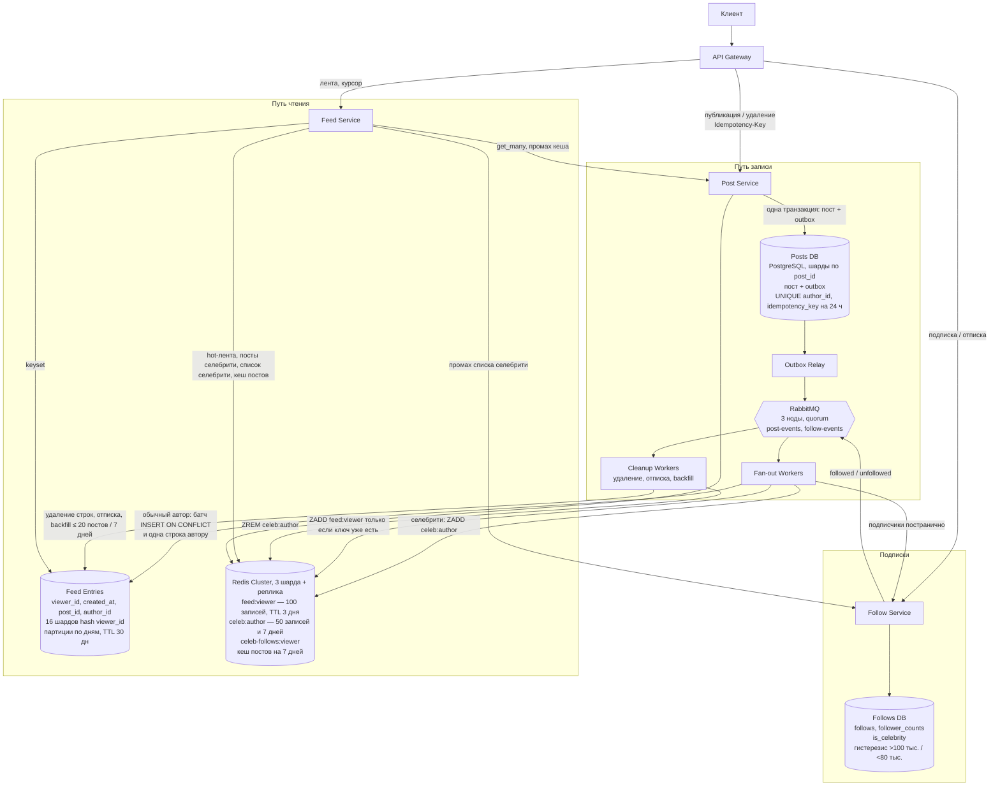

# Лента в духе Instagram

Разобрал чужой RFC к architecture review. Вводные, исходная схема и их расчёты лежат в [zadacha.md](zadacha.md).

В исходнике автор получает `post_id` только после того, как пост разложен всем подписчикам, а страница читается через `OFFSET`. Я вынес рассылку из ответа на публикацию. Крупных авторов не разворачиваю во вставку на каждого подписчика. Страницу беру курсором.

Цифры по диску, шардам и Redis посчитаны из вводной. Нагрузочного прогона не было.

## Условия

Публикуем пост (файл уже загружен, здесь только метаданные), подписываем и отписываем, отдаём главную ленту подписок: новые сверху, по 20 постов. Сразу после подписки человек видит до 20 последних постов автора за 7 дней. Удалённый пост и пост автора, от которого отписались, пропадает из новых ответов в течение минуты. Рекомендаций, рекламы и ранжирования нет.

| Требование | Цель |
|---|---|
| Публикация после загрузки фото | p95 ≤ 500 мс, p99 ≤ 1 с |
| Пост появляется у подписчика | ≤ 60 с в обычной ситуации |
| Первая страница с метаданными | p95 ≤ 300 мс, p99 ≤ 1 с на пике |
| Корректные ответы за 30 дней | лента ≥ 99,95%, публикация ≥ 99,9% |
| Подтверждённый пост | не теряется при сбое, дублей в ленте нет |

Если в ответе тихо не хватает постов, которые на самом деле были доступны, ответ некорректный.

Нагрузка из вводной: 50 млн регистраций, 10 млн активных в день, 2 млн постов и 100 млн чтений ленты в день. У обычного автора около 200 подписчиков. Есть авторы с десятками миллионов, один — на 20 млн и с 1–3 постами в день. Пик для оценки — ×10 к среднесуточной частоте. Читают в основном первые страницы.

## Что не сходится в исходном варианте

```csharp
var post = posts.Insert(authorId, mediaRef, caption);
feedService.Distribute(post.Id, authorId, post.CreatedAt); // ответ только после этого
```

`Distribute` обходит всех подписчиков и пишет строку каждому, и только потом автор получает ответ. На 200 подписчиках это уже лишняя работа внутри тех же 500 мс. На авторе с 20 млн один пост превращается в 20 млн вставок. Чтобы уложиться в 60 секунд, нужно около 333 тыс. вставок в секунду. `OFFSET` с каждой следующей страницей только дорожает. Очереди нет, поэтому подтверждённый пост доезжает до ленты, только пока жив процесс, который его раздаёт. Что делать со строками, которые уже лежат в чужих лентах, при удалении и отписке в RFC не сказано.

Арифметика исходного расчёта как нижняя граница нормальная:

| Поток | В день | Среднее | Пик ×10 |
|---|---:|---:|---:|
| Посты | 2 млн | 23/с | ~230/с |
| Чтения ленты | 100 млн | 1 160/с | 11 600/с |
| Вставки, если каждый пост × 200 подписчиков | 400 млн | 4 630/с | 46 300/с |

288 ГБ за 30 дней — это 12 млрд строк по 24 байта полезных полей. Заголовок строки Postgres и индекс в эти 24 байта не вошли. С ними строка ближе к 100 байтам, и та же куча уже 1–1,2 ТБ на одну копию. Пост автора на 20 млн в среднее «200 подписчиков» тоже не попал. Поэтому диск надо пересчитать, и крупных авторов нельзя раскладывать каждому подписчику.

## Схема



## Публикация

Клиент передаёт `Idempotency-Key`. `Post Service` в одной транзакции пишет пост и строку outbox и сразу возвращает `post_id`. Рассылка к этому моменту ещё даже не началась.

Повтор с тем же ключом в течение 24 часов возвращает тот же `post_id`. Дальше ключ умирает, и тот же запрос спустя сутки может создать второй пост. Вечный ключ я хранить не стал.

Relay публикует в RabbitMQ одно сообщение на пост: `post_id`, `author_id`, `created_at`, тип. Список подписчиков в сообщение не кладу. Он большой, и к моменту обработки уже мог измениться. Quorum-очередь на 3 нодах держит сообщение, которое брокер уже подтвердил. Outbox всё равно нужен: коммит в Postgres и publish в брокер одной транзакцией не сделать. На пике это около 230 сообщений в секунду. Упираемся во вставки в ленту, брокер тут с запасом.

Синхронную реплику Posts DB в другую зону того же региона я включил в ответ публикации. Внутри региона это миллисекунды, в 500 мс помещается. Реплика самой ленты на этот ответ не влияет: она стоит уже на пути рассылки.

## Рассылка и селебрити

Флаг `is_celebrity` лежит в Follows DB. Фон пересчитывает его по `follower_counts`: выше 100 тыс. включаем, ниже 80 тыс. выключаем. Зазор нужен, чтобы автор у порога не прыгал туда-сюда. `follows` и `follower_counts` обновляются одной транзакцией.

Класс автора фиксирую один раз, в начале обработки поста. Пока этот пост развозится, флаг не перечитываю. Начали как обычного — push дожимаем до конца. Начали как селебрити — в ленты подписчиков этот пост не пишем.

Обычный автор. Воркер идёт по подписчикам keyset-ом по `follower_id`, с реплики, и батчами делает `INSERT ... ON CONFLICT (viewer_id, post_id, created_at) DO NOTHING`. День партиции берётся из `created_at` поста, повтор попадает в ту же партицию. В PostgreSQL уникальный ключ партиционированной таблицы включает ключ партиции, без этого `ON CONFLICT` на партициях работает не так, как хочется. Плюс одна строка в ленту самого автора. По требованиям лента — это публикации подписок, своей строки там нет, но без неё автор свой пост не увидит. Если ключ `feed:{viewer_id}` уже есть, дописываю запись и туда. Нет ключа — этого зрителя в Redis не грею.

Селебрити. Один `ZADD celeb:{author_id}`. В ключе держу не больше 50 постов и не старше 7 дней. Для подписчика «появилось за 60 секунд» значит, что этот ключ уже виден чтению. Строку каждому из 20 млн мы не пишем. В обычной ленте подписчика этого поста нет. Строку самому автору пишу так же, как у обычного.

Подписка на обычного автора ставит backfill: до 20 постов за 7 дней в ленту этого зрителя. Подписка на селебрити в `Feed Entries` ничего не копирует, посты и так берутся из `celeb:{author_id}`.

Старые строки при переходе порога не переношу. Пока автор селебрити, новые посты идут только в Redis. Опустился ниже 80 тыс. — в ленты снова пишем только то, что вышло после этого. Если один `post_id` окажется в двух местах, на чтении его схлопнем. Вычищать старые строки у всех подписчиков отдельно я не буду: по объёму это та же полная рассылка.

Удалённый пост воркер не вставляет. Если событие удаления приехало раньше вставки, строка из этого не появляется.

Автор на 100 тыс. подписчиков — около 100 тыс. строк на пост, около 6 тыс. на шард. На фоне 3 тыс. вставок в секунду такая пачка короткая, пока таких авторов мало. Несколько авторов у порога в одну минуту я отдельно не считал: во вводной нет распределения между 200 и 100 тыс. Это надо прогнать на стенде.

## Чтение

Курсор непрозрачный: `base64(created_at, post_id)` последнего поста, который уже отдали. Пока человек листает и выходит новый пост, он попадает на первую страницу и в уже пройденный кусок не вклинивается.

`Feed Service` читает два источника и склеивает их одним курсором.

- Своя лента: ZSET `feed:{viewer_id}` на 100 записей, это первые 5 страниц. TTL 3 дня, если человек не заходит. Промах — одна выборка из `Feed Entries` и запись ключа. По памяти: 10 млн активных × 100 × ~40 байт ≈ 40 ГБ полезной нагрузки. Накладные структуры Redis сверху, в оценку я их не клал.
- Селебрити: список id из `celeb-follows:{viewer_id}`, потом `ZRANGE` по `celeb:{author_id}`. Промах списка — одно чтение Follows DB и заполнение ключа. Follow и unfollow этот ключ сбрасывают. Если самих постов селебрити в Redis нет, беру их из Posts DB по индексу `(author_id, created_at DESC)`.

Посты селебрити в hot-ключ зрителя я специально не кладу. Иначе человек попал в кеш, и селебрити пропадают из ленты до конца TTL. Поэтому склейка на каждом чтении, даже когда `feed:{viewer_id}` уже тёплый.

Дальше слияние по `(created_at, post_id)` по убыванию. Если селебрити-подписок много — min-heap и top-K. Дубли по `post_id` выкидываю, удалённые тоже, и тех, на кого зритель уже не подписан. Обрезаю до 20. Читаю с запасом ×2. Если после фильтра осталось меньше 20, а лента ещё не кончилась, читаю ещё. Курсор ставлю по последнему посту, который ушёл клиенту.

Метаданные — батч `get_many` из Redis, окно 7 дней, при удалении ключ сбрасываю. 2 млн постов в день × 7 × около 1 КБ ≈ 14 ГБ. Вместе с hot-лентой это десятки гигабайт на три шарда Redis. Пиковые 11 600 чтений × 20 постов дают около 232 тыс. обращений к посту в секунду, и в Posts DB они не идут: туда попадает промах. Упал один шард Redis — короткую страницу не отдаю, запрос целиком падает ошибкой.

По первой странице на тёплом кеше я разложил бюджет, замера нет: gateway около 20 мс, Redis около 30 мс, склейка и фильтр около 10 мс. До 300 мс ещё есть запас. Промах hot-ленты добавляет один keyset по шарду зрителя. В p99 до секунды повторное чтение помещается.

Историю селебрити я урезал: 7 дней и 50 постов, тогда как в `Feed Entries` посты живут 30 дней. Пост селебрити старше недели в главной ленте уже не появится. У автора с 1–3 постами в день это примерно неделя. Ключ `celeb` читается на каждом запросе ленты подписчика, тащить туда месяц обычных авторов я не хотел. Месяц обычных авторов остаётся в Postgres.

Если Redis лёг, ленту читаем из `Feed Entries` и Posts DB, фильтр удалённых остаётся. 300 мс и пик 11 600/с в этом режиме я не держу. Лимит на такие запросы нужен, чтобы праймари не легли. Саму цифру лимита пусть даст тест.

## Удаление и отписка

Минуту из требований закрывает фильтр на чтении. Пока фон не дошёл, новый ответ пост уже не содержит. Страницу, которую клиент уже показал, сервер задним числом не отзывает.

Удаление помечает пост в Posts DB и кладёт `post-deleted` в outbox. Cleanup делает `ZREM` из `celeb:{author_id}`. Для обычного автора он ещё раз обходит подписчиков и удаляет строки по шардам зрителей. Это уборка диска, на продуктовую минуту она не завязана.

Отписка убирает связь в Follows и сбрасывает `celeb-follows` зрителя. Фоновый воркер читает строки одного `viewer_id` и выкидывает нужный `author_id`. Индекса по автору нет: отписка редкая, а индекс платил бы на каждой вставке. Это держится, пока у одного зрителя за 30 дней сотни строк. Если окажутся десятки тысяч, индекс придётся добавить.

Партиции по дню снимаю `DROP PARTITION`. Массовым `DELETE` по TTL не хожу.

## Железо

| | |
|---|---|
| Feed Entries | 16 логических шардов по `hash(viewer_id)`. Старт: 4 праймари, по 4 шарда. Пик около 3 тыс. батч-вставок/с на шард (46 300 / 16) и около 12 тыс./с на машину |
| Машина ленты | 8 vCPU, 32–64 ГБ RAM, NVMe 1–2 ТБ |
| Копии | primary, синхронная реплика в другой зоне (RPO ≈ 0), асинхронная реплика для чтения |
| Диск | 1–1,2 ТБ на одну копию. Три копии — около 3,6 ТБ. На один праймари приходится около 300 ГБ |
| Регион | один регион, 2–3 зоны. Мультирегион в MVP нет |
| Redis | кластер из 3 шардов и реплика на каждый |
| RabbitMQ | 3 ноды, quorum |

Четыре сервера — это праймари одной копии. Синхронная и асинхронная реплики — ещё машины того же класса. Лимит в 100 записей и отказ греть тех, кто давно не заходил, режут память Redis. На Postgres это почти не влияет: строка ленты всё равно пишется каждому подписчику обычного автора. Кучу Postgres уменьшает гибрид, посты селебрити в эти 12 млрд строк не входят.

Перед Postgres стоит пулер, чтобы число соединений не росло вместе с лагом очереди. Лаг relay или потребителей в 15–20 секунд я бы уже заводил как инцидент: до продуктовых 60 секунд должен оставаться запас. Relay, fan-out и cleanup отдал бы одному владельцу. Иначе лаг смотрят трое, и не смотрит никто.

Шарды Posts DB по `post_id` я оставил. Outbox пишется рядом с постом, чтение точечное. 230 записей в секунду и десятки гигабайт метаданных один Postgres по диску вытянет. Шарды здесь нужны, чтобы relay и `get_many` не делили одну машину.
