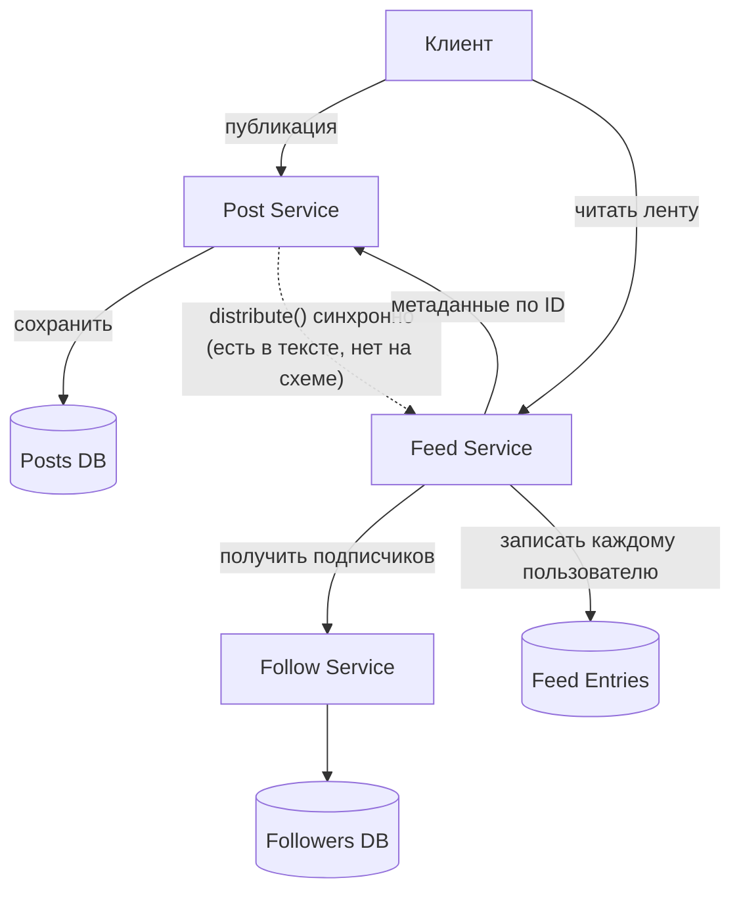
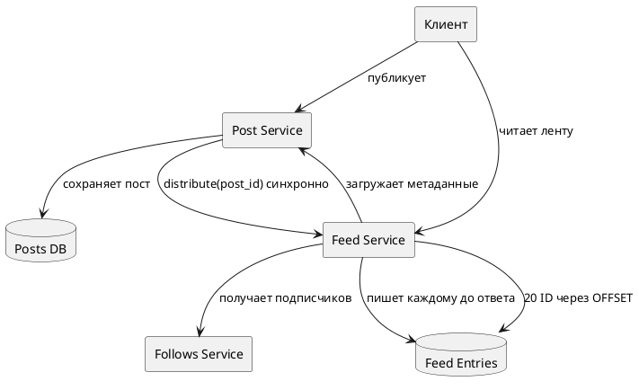

# Исходная задача

Постановка, от которой сделан разбор в [README.md](README.md). Ниже вводные и исходный дизайн, без исправлений.

## Схема исходного варианта



## Контекст

Staff Engineer в продуктовой компании смотрит чужой RFC системы instagram-like перед Architecture Review и авторизацией MVP. Нужно уточнить требования, проверить расчёты, найти проблемы и предложить исправленный дизайн. Это ревью существующей системы, а не проектирование приложения с нуля.

## Функциональные требования

Система позволяет:

- Опубликовать пост с фотографией. Загрузка и доставка самого файла уже решены; в этой задаче работаем с метаданными поста и лентой.
- Подписаться на автора и отписаться от него.
- Получить главную ленту: публикации текущих подписок в обратном хронологическом порядке, по 20 постов на страницу.
- После подписки увидеть до 20 последних постов автора за семь дней.
- Удалить публикацию. Удалённые посты и посты авторов, от которых пользователь отписался, перестают попадать в новые ответы ленты.

Рекомендации, реклама, Stories, сообщения и ранжирование постов в задачу не входят.

## Нефункциональные требования

- Отвечать на запрос публикации после загрузки фотографии за p95 не более 500 мс и p99 не более 1 с.
- Новая публикация должна появиться в ленте подписчика в течение 60 секунд в обычной ситуации.
- Первая страница ленты с метаданными должна отвечать за p95 не дольше 300 мс и p99 не дольше 1 с при расчётной пиковой нагрузке. Время загрузки изображения измеряется отдельно.
- За скользящие 30 дней не менее 99,95% допустимых запросов ленты должны завершаться корректным ответом; для публикации — не менее 99,9%. Ответ, молча потерявший часть доступных публикаций, не считается корректным. Эти целевые значения — вводные учебного кейса, их стоимость и достижимость можно обсуждать.
- Подтверждённая публикация не должна навсегда теряться при сбое. Дубликатов в ленте быть не должно.
- После отписки или удаления пост исчезает из новых ответов ленты в течение минуты.

## Данные по использованию

- 50 млн зарегистрированных пользователей; 10 млн активных пользователей в день.
- 2 млн новых постов и 100 млн запросов главной ленты в день.
- У обычного автора около 200 подписчиков. Есть авторы с десятками миллионов подписчиков; у одного из них 20 млн, он публикует 1–3 поста в день.
- Для предварительной оценки пика принять нагрузку в 10 раз выше среднесуточной частоты.
- Первая страница содержит 20 постов; основной сценарий — первые несколько страниц.

## Что было спроектировано

1. `Post Service` сохраняет пост в своей базе и синхронно вызывает `Feed Service.distribute(post_id, author_id)`. Ответ автору возвращается только после ответа `Feed Service`.
2. `Feed Service` получает подписчиков через `Follows Service` и добавляет ссылку на пост в ленту каждого подписчика. `Feed Entries` хранит строки `(viewer_id, created_at, post_id)` в течение 30 дней.
3. При чтении `Feed Service` выбирает очередные 20 ссылок через `OFFSET` и запрашивает метаданные постов у `Post Service`.
4. При отписке удаляется связь в `Follows Service`, при удалении поста — запись в `Posts DB`. Что делать со ссылками, уже попавшими в ленты, не описано.

Локальный прототип: публикация и чтение ленты работают на небольшом наборе данных. Очереди и кеша нет.



Фрагмент прототипа:

```csharp
class PostService
{
    public long Publish(long authorId, string mediaRef, string caption)
    {
        var post = posts.Insert(authorId, mediaRef, caption);
        feedService.Distribute(post.Id, authorId, post.CreatedAt);
        return post.Id;
    }
}

class FeedService
{
    public void Distribute(long postId, long authorId, DateTime createdAt)
    {
        foreach (var viewerId in followsService.AllFollowers(authorId))
            feedEntries.Insert(viewerId, createdAt, postId);
    }

    public IReadOnlyList<Post> GetFeed(long viewerId, int page, int size = 20)
    {
        var ids = feedEntries.Query(viewerId, offset: page * size, limit: size);
        return postService.GetMany(ids);
    }
}
```

## Расчёты исходного варианта

| Показатель | Расчёт | Вывод |
|---|---|---|
| Публикации | `2 млн / 86 400` | Около 23/с в среднем, 230/с при пике ×10. |
| Чтения ленты | `100 млн / 86 400` | Около 1 160/с в среднем, 11 600/с при пике ×10. |
| Вставки в ленты | `2 млн постов × 200 подписчиков` | 400 млн/день; около 4 630/с в среднем и 46 300/с при пике ×10. |
| Хранение ссылок за 30 дней | `400 млн строк/день × 24 байта × 30` | Около 288 ГБ логических данных без индексов, реплик и накладных расходов. |
